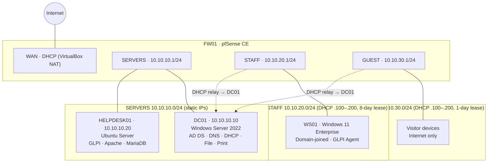
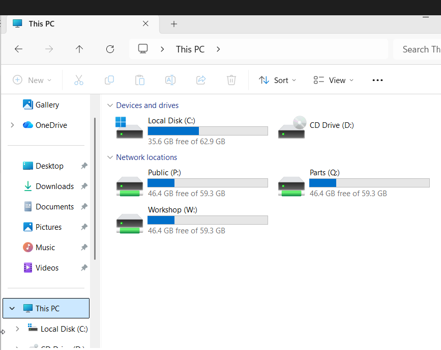
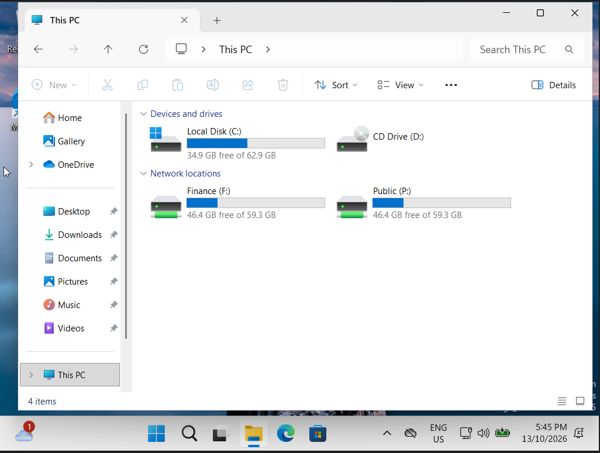

# Moon Motor Group – IT Support Homelab

A simulated small-business IT environment that I built, operate and support as the sole IT Support Officer for a fictional 15-person automotive dealership, **Moon Motor Group** (sales floor, service workshop, parts counter, finance and management).

The goal of this project is to demonstrate day-to-day IT support work end to end: building and securing the environment, deploying devices, managing accounts and access, tracking assets, working tickets, automating repetitive tasks, and documenting everything for both staff and technicians.

> Everything here is fictional and lab-only. No real company, staff or credentials are used.

---

## At a glance

| Area | What I built |
| --- | --- |
| **Network** | pfSense CE firewall with three segmented networks (Servers, Staff, Guest) and least-privilege firewall rules |
| **Identity** | Windows Server 2022 Active Directory domain (`ad.moonlab.internal`) with DNS and centrally-managed DHCP |
| **Access control** | Department OUs and AGDLP security groups controlling shared drives and printers |
| **Group Policy** | Automatic drive mapping, printer deployment, password and lockout policy, USB blocking, logon banner, screen lock |
| **Endpoints** | Windows 11 Enterprise workstation joined to the domain and tested per user and department |
| **Helpdesk & assets** | GLPI 12 on Ubuntu Server: ticketing, knowledge base and asset lifecycle, integrated with Active Directory (LDAP) |
| **Inventory** | GLPI Agent on Windows endpoints and servers reporting hardware and software automatically each day |
| **Automation** | PowerShell scripts for onboarding, offboarding and a weekly AD data-quality report |
| **Documentation** | Network diagram, runbooks, on-call guide, staff knowledge-base articles, ticket write-ups |

---

## Network diagram

### Firewall policy summary

| From | To | Allowed |
| --- | --- | --- |
| STAFF | DC01 | Yes (AD, DNS, file and print) |
| STAFF | HELPDESK01 | TCP 80/443 only (helpdesk portal) |
| STAFF | Other internal networks | **Blocked** |
| STAFF | Internet | Yes |
| GUEST | pfSense | DNS (53) only |
| GUEST | Any internal network (incl. firewall admin) | **Blocked** |
| GUEST | Internet | Yes |

---

## Who gets what

Access is driven entirely by group membership. Adding a person to one department group gives them everything their role needs.

| Department | Group | Drives | Printer |
| --- | --- | --- | --- |
| Sales | `GG_Sales` | P: Public, S: Sales | — |
| Service | `GG_Service` | P: Public, W: Workshop, Q: Parts | PARTS-Printer-01 |
| Parts | `GG_Parts` | P: Public, Q: Parts | PARTS-Printer-01 |
| Finance | `GG_Finance` | P: Public, F: Finance | — |
| Management | `GG_Management` | P, S, W, Q, F | — |
| IT | `GG_IT` | P: Public | — |

Verified on the same PC with two different users:

| Service Advisor | Finance |
| --- | --- |
|  |  |

All evidence: [`screenshots/`](screenshots/).

---

## Repository contents

| Folder | Contents |
| --- | --- |
| [`docs/01-build-guide.md`](docs/01-build-guide.md) | How the environment was built, phase by phase |
| [`docs/02-security-hardening.md`](docs/02-security-hardening.md) | Security controls applied and why |
| [`docs/03-lab-vs-production.md`](docs/03-lab-vs-production.md) | What I would do differently in a real business |
| [`docs/runbooks/`](docs/runbooks/) | Step-by-step technician procedures, including weekend on-call |
| [`kb-articles/`](kb-articles/) | Plain-English help articles published to staff in GLPI |
| [`scripts/`](scripts/) | PowerShell automation (onboarding, offboarding, AD report) |
| [`tickets/`](tickets/) | Ticket write-ups: symptom, diagnosis, root cause, fix, prevention |
| [`screenshots/`](screenshots/) | Evidence from each phase |

---

## Selected tickets

| # | Issue | Root cause | Skills shown |
| --- | --- | --- | --- |
| [001](tickets/001-missing-department-drives.md) | Service Advisor missing Workshop and Parts drives | Department groups empty after account creation | `whoami /groups`, AGDLP, GPO item-level targeting, checking blast radius |
| [002](tickets/002-helpdesk-server-no-ip.md) | New helpdesk server unreachable | Static IP not applied at install; servers subnet has no DHCP by design | Linux networking, netplan, structured diagnosis |
| [003](tickets/003-account-disabled-at-creation.md) | Staff member missing from helpdesk | Account created disabled | AD attributes, replication metadata, LDAP testing |
| [004](tickets/004-must-change-password-web-login.md) | New starter can't log in to web portal | "Must change password at next logon" blocks LDAP logins | AD account flags, onboarding process |

---

## Skills demonstrated

- **Windows Server & Active Directory:** OUs, users, security groups (AGDLP), DNS forward and reverse zones, DHCP scopes and relay
- **Group Policy:** drive maps, printer deployment, item-level targeting, security baselines, `gpresult` troubleshooting
- **Networking:** subnetting, segmentation, firewall rule ordering, DHCP relay, DNS forwarding and domain overrides
- **Linux:** Ubuntu Server build, netplan static networking, Apache, MariaDB, package management, SSH administration
- **ITSM:** ticket lifecycle (raise, assign, follow up, task, solve, approve), categories, knowledge base, asset lifecycle
- **Automation:** PowerShell with input validation, verification steps and CSV audit logs
- **Security:** least privilege, separate admin accounts, service accounts, default-credential removal, agent authentication

---

## Lab platform

Built on a single Windows host with Oracle VirtualBox 7.2 (16 GB RAM).

| VM | OS | vCPU | RAM |
| --- | --- | --- | --- |
| FW01 | pfSense CE 2.9 | 1 | 1 GB |
| DC01 | Windows Server 2022 Standard (Evaluation) | 2 | 4 GB |
| HELPDESK01 | Ubuntu Server 26.04 LTS | 2 | 2 GB |
| WS01 | Windows 11 Enterprise (Evaluation) | 2 | 4 GB |

---

*Author: Chaitanya Moon · Master of Cybersecurity, Griffith University · [LinkedIn](https://www.linkedin.com/in/chaitanyamoon7)*
