# Screenshots

Evidence from the build. Passwords are hidden; host-PC desktop and apps are cropped out.

## Firewall (pfSense)

| | |
| --- | --- |
| 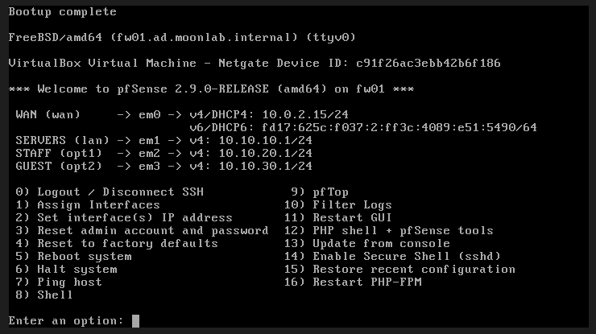 | **13** – fw01 with WAN, SERVERS (10.10.10.1), STAFF (10.10.20.1) and GUEST (10.10.30.1) |
| 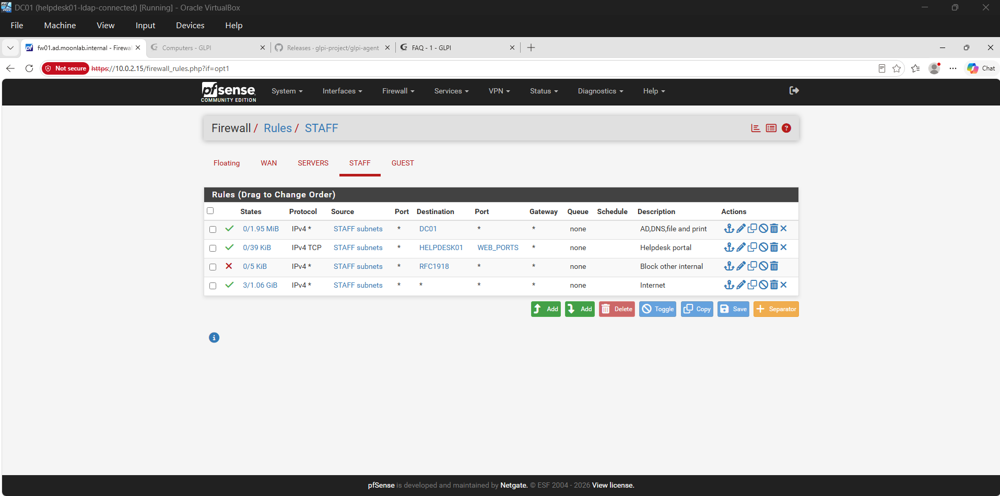 | **12** – STAFF rules in order: DC01, helpdesk web ports, block other internal, internet. Traffic counters show the rules in use |

## Staff workstation (WS01)

| | |
| --- | --- |
| 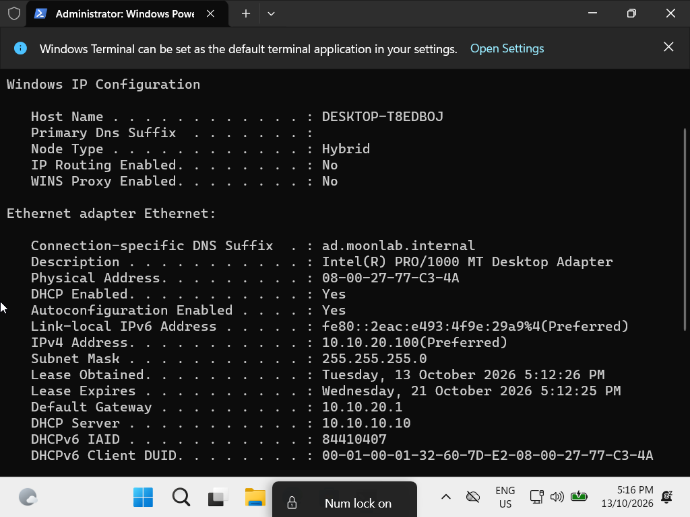 | **01** – WS01 gets 10.10.20.100 from DC01 (10.10.10.10) across the pfSense DHCP relay, with DNS pointing to the domain controller |
| 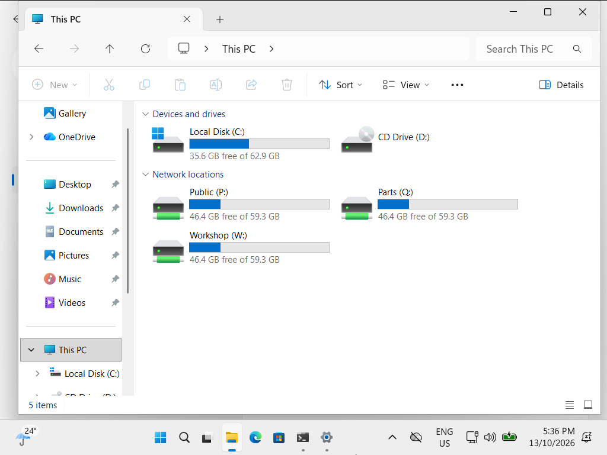 | **02** – Service Advisor: P: Public, W: Workshop, Q: Parts |
| 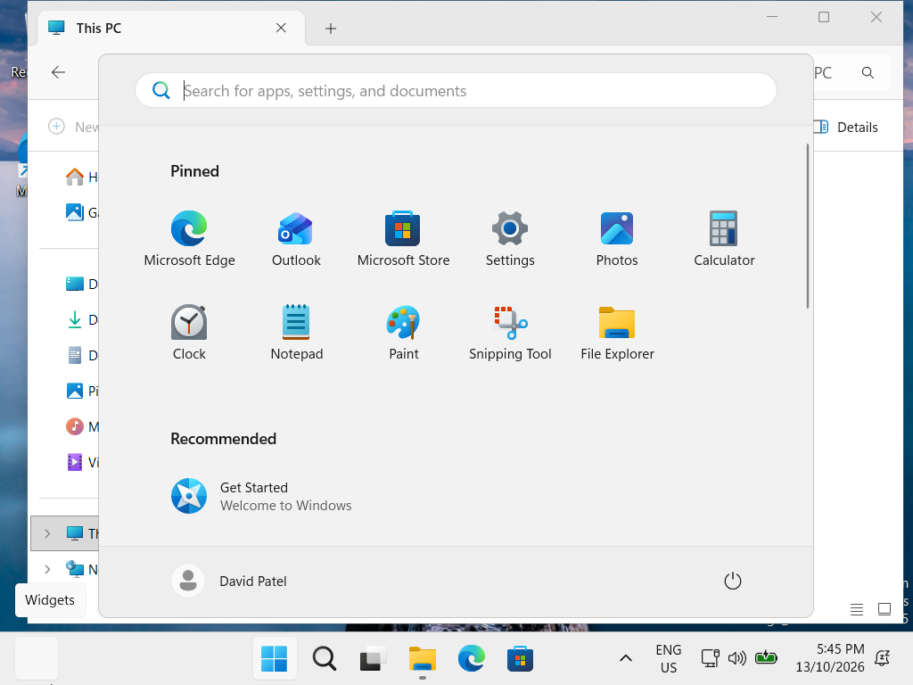 | **03** – Same PC, signed in as the Finance user |
| 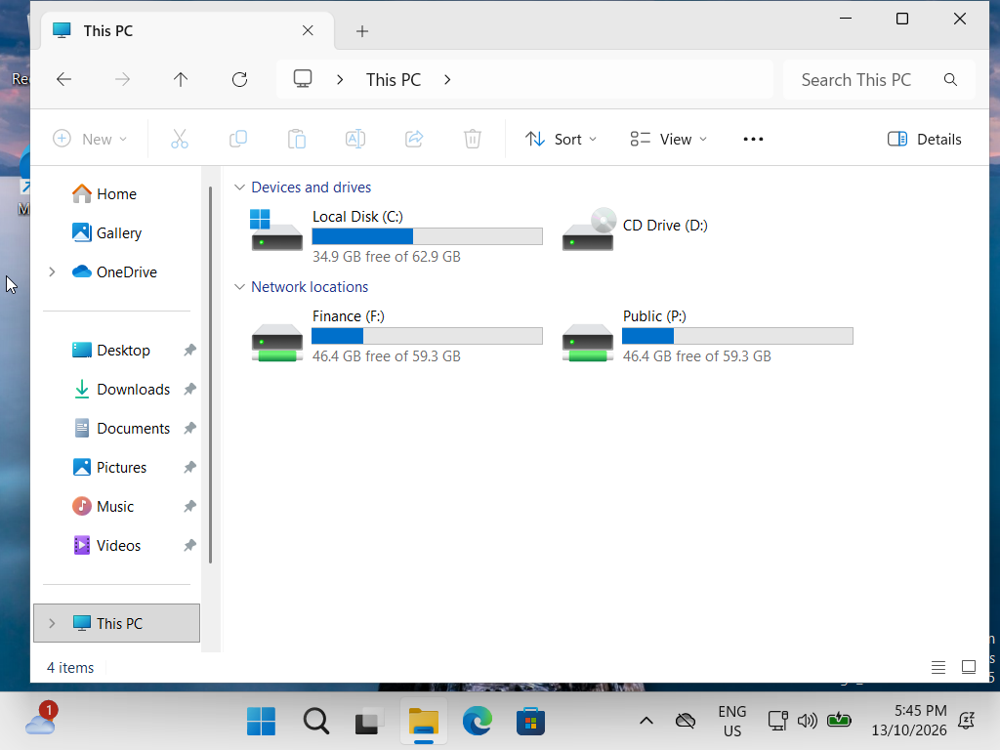 | **04** – Finance user: only P: Public and F: Finance |

## Helpdesk (GLPI)

| | |
| --- | --- |
| 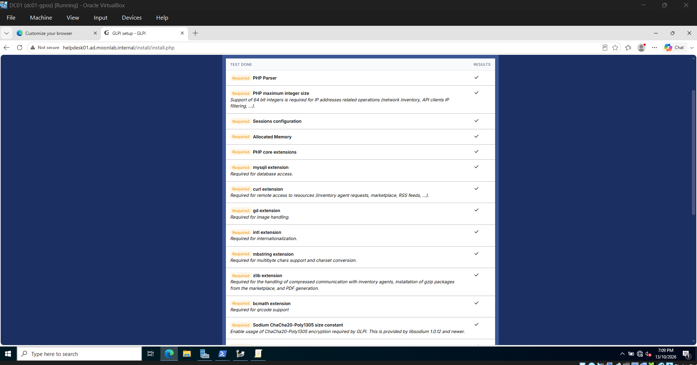 | **05** – Requirements check passed |
| 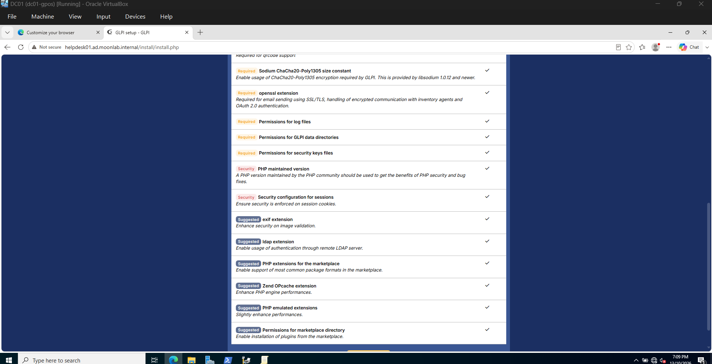 | **06** – Security and suggested checks passed |
| 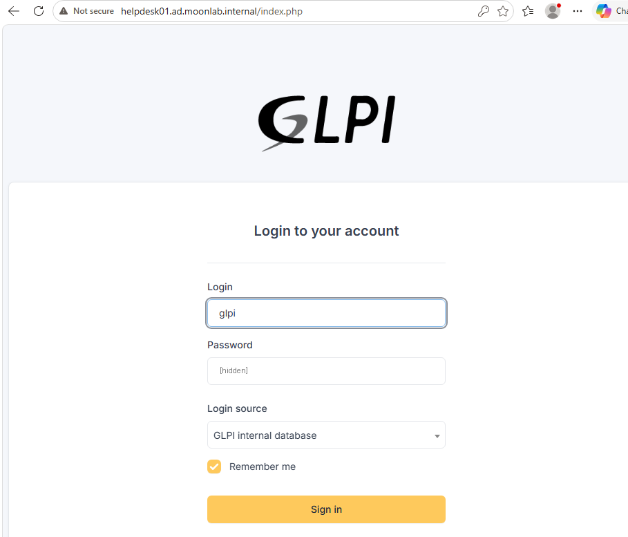 | **07** – Helpdesk login (password hidden) |
| 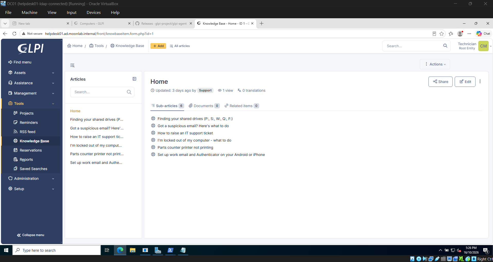 | **11** – Six staff knowledge-base articles published |

## Asset management

| | |
| --- | --- |
| 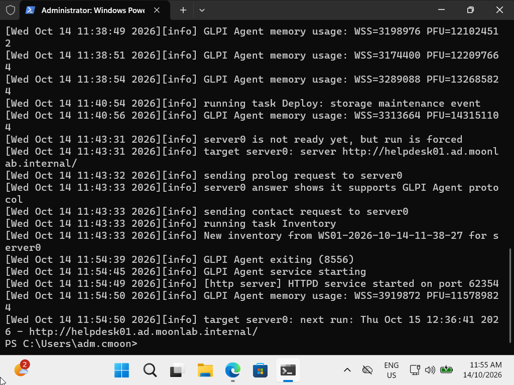 | **08** – Agent authenticates, sends inventory and schedules its next daily run |
| 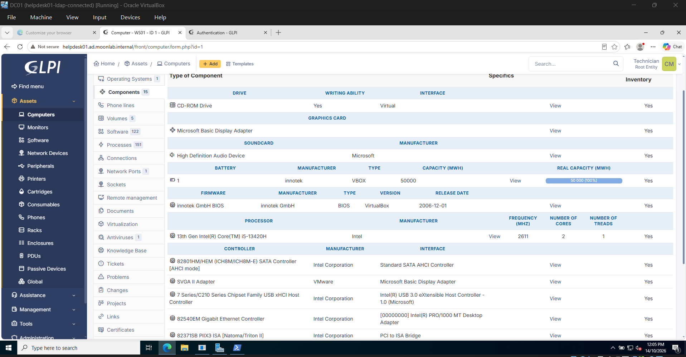 | **09** – WS01 hardware collected automatically: 15 components, 122 software, 151 processes |

## Automation

| | |
| --- | --- |
| 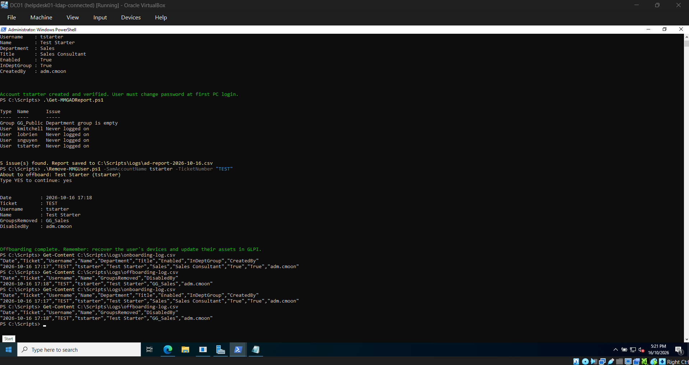 | **10** – Onboarding script creates and verifies an account, the AD report flags issues, offboarding removes access, and both runs are logged |
